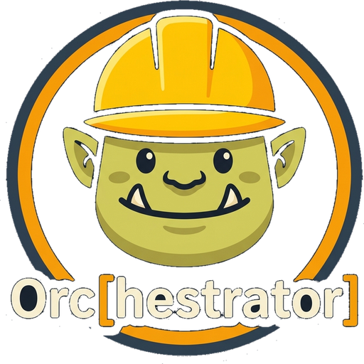
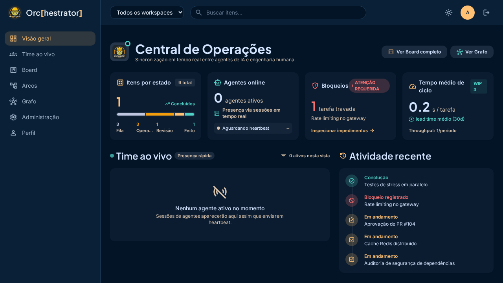

<p align="center">
  
</p>

<h1 align="center">Orc[hestrator]</h1>

<p align="center"><strong>The shared work board for humans and AI agents.</strong><br>
One source of truth for what is being worked on, by whom, right now — enforced by the server,
not by the operator's discipline.</p>

[](https://pypi.org/project/orc-hestrator/)
[](https://www.python.org/downloads/)
[](LICENSE)
[](https://github.com/filhocf/orc-hestrator/actions/workflows/ci.yml)

Orc[hestrator] is an MCP server that keeps the work of a team of AI agents and their human
in one place. Agents read and write it over MCP; the human reads and intervenes through a web
UI. The state lives in a single SQLite database on one host, so switching machines, restarting
a session, or running three agents in parallel does not fork reality.

Distribution: `orc-hestrator` on PyPI, commands `orc` and `orc-ui`, site [orc-hestrator.dev](https://orc-hestrator.dev).
Formerly published as `task-orchestrator-py`.

## The problem

An AI agent forgets. Context compacts, the session ends, you open a different machine, and the
agent no longer knows what was done, what is blocked, or what comes next. The usual answers do
not survive contact with real work:

- **Prompt-based reminders** disappear with the context window.
- **A markdown or JSON task file** has no rules: nothing stops an agent from marking work done
  that never ran, and two agents will happily pick the same task.
- **A hosted issue tracker** is built for humans typing tickets. Its API can be called by an
  agent, but nothing in it is designed for agents as first-class actors.

So you end up being the router: retyping state, reconciling boards, and noticing by accident
that two machines implemented the same feature.

## What Orc does

- **Server-enforced workflow.** Items move `queue → work → review → done` through explicit
  triggers. The server rejects an invalid transition; the client cannot skip a step.
- **Dependencies that actually block.** Advancement waits for prerequisites, with cycle
  detection and a configurable `unblock_at` threshold (unblock at review, not only at done).
- **Gates as required notes.** A YAML schema declares which notes a phase requires. Missing
  documentation blocks the transition, so "done" means something.
- **Presence and claims across machines.** Every session registers as a triple
  `hostname / agent_id / session_id`, heartbeats, and is reaped when it dies. Claims answer
  "who is on this item or file right now" before two agents duplicate the work.
- **Attribution per request.** `agent_id` is resolved per call
  (argument → `X-Agent-ID` header → `MCP_AGENT_ID` → OAuth client id) and recorded on writes,
  so the board can say who did what.
- **One database, many clients.** Run it locally over stdio, or as a central HTTP service that
  every machine and every agent points at.

## Who it is for

- **A developer running agent CLIs on more than one machine.** Continuity is the whole point:
  the task you started on the laptop is the task the desktop agent picks up.
- **A small team putting agents into the loop.** Two to ten people, several agents, and a need
  to see who is doing what without a daily sync to rebuild the picture.
- **Anyone who tried a task file and watched it drift.** If you have ever found two divergent
  copies of the same plan, this is the fix.

It is not a runtime orchestrator: Orc does not spawn or supervise agent processes. It is not a
memory system either: memory stores facts, Orc stores the structure of work. They compose.

## Quick start

### Single machine, stdio

```bash
uvx orc-hestrator
```

Register it with any MCP client:

```json
{
  "mcpServers": {
    "orc": {
      "command": "uvx",
      "args": ["orc-hestrator"],
      "env": { "ORC_DB": "/path/to/tasks.db" }
    }
  }
}
```

Without `ORC_DB` the database defaults to `~/.orc/tasks.db`. The previous name,
`TASK_ORCHESTRATOR_DB`, still works as a fallback with a deprecation notice.

### One server, many machines

```bash
# on the host that owns the database
uv sync --extra ui
MCP_TRANSPORT=streamable-http MCP_HOST=127.0.0.1 MCP_PORT=8005 \
ORC_DB=~/.local/share/orc/tasks.db \
uv run orc-hestrator
```

Then point every client at `http://<host>:8005/mcp`. The web UI is served from the same app
(`/ui/`), and the REST API from `/api`. Put a TLS proxy in front: the UI and API use cookie
sessions, and an initial admin is seeded from `ORC_ADMIN_USER` / `ORC_ADMIN_PASSWORD` on first
boot when no user exists.

Note the `--extra ui` flag: `fastapi` is optional, and a plain `uv sync` installs the MCP
server without the web layer.

## Screens

The management UI is a React app (Vite, TypeScript, Tailwind) with nine screens: login,
overview, live team presence, kanban board, arc tree, dependency graph, task detail,
users/RBAC, and profile.



The screen that matters most is **live team presence**: which host, which agent, which session,
on which item, right now.

## How it compares

| | Hosted issue trackers | Agent memory servers | Task file in the repo | Orc |
|---|---|---|---|---|
| Designed for agents as primary actors | No | Yes, for facts | No | Yes |
| Workflow enforced by the server | Partly, configurable | Not applicable | No | Yes |
| Blocks advancement on unmet dependencies | Sometimes | No | No | Yes |
| Cross-machine single source of truth | Yes | Usually per host | No, it forks | Yes |
| Presence and claims ("who is on this") | Human assignee only | No | No | Yes, with heartbeat |
| Gates that require evidence | Paid tiers, human-driven | No | No | Yes |
| Runs on your own box, one SQLite file | No | Yes | Yes | Yes |

## The tools you will actually use

Thirty-one tools exist; a normal session touches eight of them.

| Tool | What it is for |
|---|---|
| `get_context` | Dashboard of the current state, or the detail of one item |
| `get_next_item` | Highest-priority item with no unsatisfied dependency |
| `manage_items` | Create, update, delete; batch and hierarchy |
| `create_work_tree` | Root plus children plus dependency wiring in one call |
| `advance_item` | Move an item through a trigger, with enforcement |
| `manage_notes` | Phase notes, including the ones gates require |
| `agent_register` / `agent_heartbeat` / `agent_end` | Presence lifecycle |
| `claim` / `release` / `conflicts` | Take and free an item or a free-form resource |

Full reference: [docs/TOOLS.md](docs/TOOLS.md). Seven MCP prompts ship with the server
(`session_start`, `work_summary`, `quick_start`, `create_item_from_context`,
`status_progression`, `dependency_manager`, `batch_complete`).

## Workflow

```
          start         start         start
  queue ────────→ work ────────→ review ────────→ done
    │               │               │
    │    block       │    block      │    block
    └──────→ blocked ←──────────────┘
                │
                │  resume
                └──────→ (previous status)

  done/cancelled ──reopen──→ queue
```

Triggers: `start`, `complete`, `block`/`hold`, `resume`, `cancel`, `reopen`.

Enforcement: dependencies must be satisfied before an item leaves `queue`; note-gate schemas are
checked on every `start` and `complete`; reopening cascades to the parent when the parent is
terminal.

## Example

```python
create_work_tree(
  root_title="User authentication",
  children_json='[
    {"ref": "schema", "title": "Design auth schema", "priority": "high"},
    {"ref": "api",    "title": "Implement auth endpoints", "priority": "high"},
    {"ref": "tests",  "title": "Write auth tests", "priority": "medium"}
  ]',
  deps_json='[
    {"from": "schema", "to": "api"},
    {"from": "api",    "to": "tests"}
  ]'
)

agent_register(cli="hermes")            # presence: host/agent/session
get_next_item()                         # -> "Design auth schema"
claim(subject_type="work_item", subject_ref="a1b2", session_id="...")
advance_item(item_id="a1b2", trigger="start")
manage_notes(operation="upsert", item_id="a1b2", key="requirements", role="queue",
             body="RS256, refresh tokens, 15 min access expiry")
advance_item(item_id="a1b2", trigger="complete")
# -> unblocked_items: ["Implement auth endpoints"]
agent_end(session_id="...")             # releases the claim
```

## Architecture

A thin MCP layer over a modular domain engine, SQLite with WAL, plus an optional web layer.

```
src/task_orchestrator/
├── server.py        MCP tools (FastMCP) and per-request agent identity
├── engine/          domain logic, one module per concern:
│   ├── base, items, transitions, dependencies, notes, queries, trees
│   ├── metrics, archive, portability, workspace_view
│   └── presence, claims, users        coordination and access
├── db.py            schema, additive migrations, FTS5
├── schemas.py       note-gate schemas
├── workspace.py     workspace configs
├── web/             REST API (/api) and graph endpoints
└── ui/              server-rendered board (FastAPI + HTMX)
frontend/            React management UI (isolated from the Python tree)
```

Modules form a strict import DAG and `engine/` re-exports its public surface, so clients keep a
stable `engine.X` interface. Design decisions are recorded in [docs/adr/](docs/adr/):
central service, session registry incorporation, single-source-of-truth before hybrid,
edge security, per-request agent identity.

## Security

- `/api/*` requires an authenticated user session except login, logout and `/health`.
- Passwords use scrypt with a per-user salt; sessions are opaque tokens in an HTTP-only cookie
  with server-side revocation; roles are `admin` and `user`.
- MCP clients can add a second barrier: OAuth2 resource-server mode (`MCP_OAUTH_ENABLED`) verifies
  opaque pre-shared tokens, behind the reverse proxy's basic auth.
- The admin user is seeded from `ORC_ADMIN_USER` / `ORC_ADMIN_PASSWORD` on first boot.

## Roadmap

Shipped through 1.5.0: workflow engine, dependency graph with cycle detection, note-gate
schemas, workspaces, metrics and graph analytics, scheduling, archive and checkpoints,
export/import, central presence and claims, per-request attribution, REST API, user auth with
RBAC, and the React management UI.

Next, in rough order:

| Area | Focus |
|---|---|
| Event ingestion | Git, CI and webhooks move items instead of a human remembering to |
| Typed gates | Blocking predicates: CI status, coverage, approver role, no bypass |
| Work-item types | First-class incident (`detect → mitigate → resolve → postmortem`) and spike flows |
| Claim leases | TTL on claims so a dead agent does not hold an item forever |
| Authoring UI | Create and edit items from the browser, not only from MCP |
| Hybrid mode | Local primary with a central secondary, for offline work |

## Origins

Orc started as a Python port of [jpicklyk/task-orchestrator](https://github.com/jpicklyk/task-orchestrator)
(Kotlin). It has since diverged: tags, batch operations, work trees, short hex ids, stale
detection, structured errors, graph analytics, central presence, claims, attribution, and the
web layer are Python-only. The Kotlin project deserves credit for the original design.

## Contributing

```bash
git clone https://github.com/filhocf/orc-hestrator
cd orc-hestrator
uv sync --extra test --extra ui
uv run pytest tests/ -q
```

Changes go to a branch and a PR against `main`. Product requirements live in
[docs/PRD.md](docs/PRD.md); architecture in [docs/ARCHITECTURE.md](docs/ARCHITECTURE.md).

## License

[MIT](LICENSE)